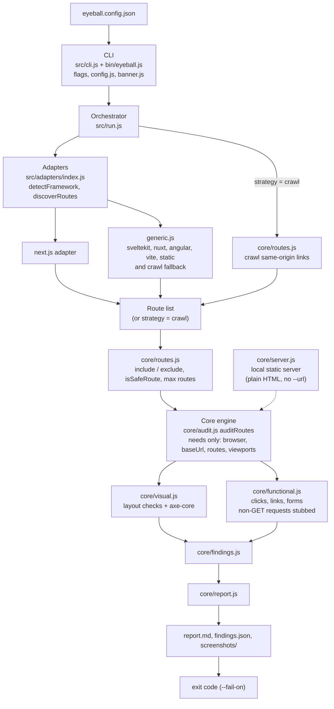
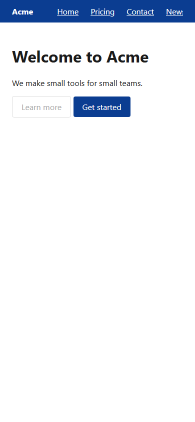
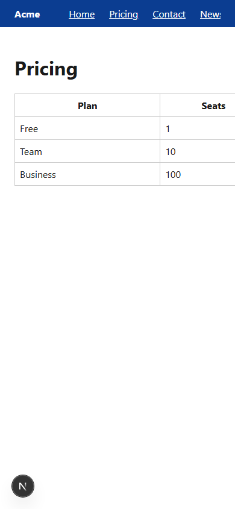
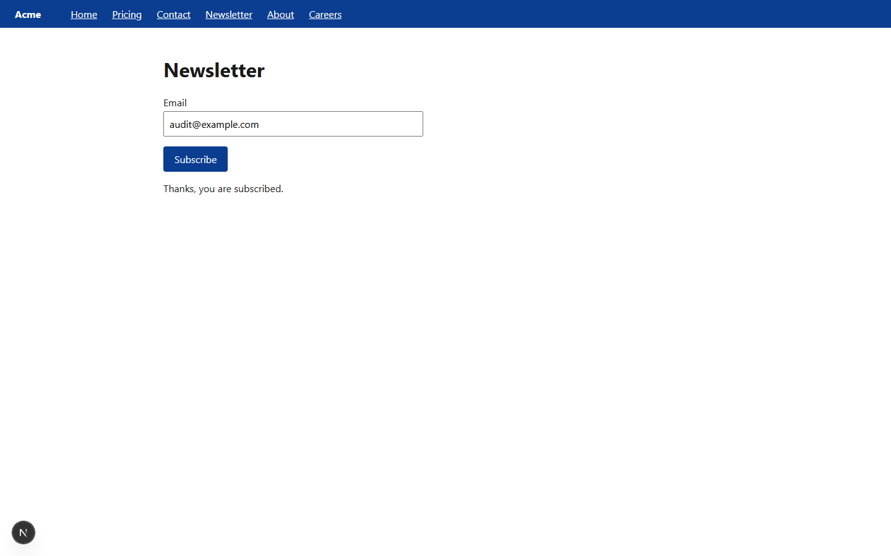

# eyeball

Part of **WOMM** ("Works On My Machine"), a growing set of developer tools. Eyeball is the first one.

> Package name: `@imanueldev/eyeball`. Command: `eyeball`. Version 0.1.0, early.

Eyeball is an autonomous, framework-aware frontend QA agent that inspects rendered applications, tests interactions, captures visual evidence, identifies UI/UX, accessibility and functional issues, and verifies fixes.

What that means today: eyeball opens your running frontend in a real headless Chromium, takes screenshots at several screen widths, clicks things, fills forms, and reports visual, accessibility and functional problems. Each finding comes with evidence: a measured number, a request count, an HTTP status or a screenshot. The "verifies fixes" part is manual for now: run it again after a fix and compare reports. There is no built-in before/after comparison yet.

## The problem

Code can look right and the page can still be broken: a link that goes nowhere, a button that does nothing, a form that sends twice on a double click, a table that pushes the page wider than a phone. Unit tests and linters do not see these. Eyeball looks at the rendered page and at what happens when you use it.

## Status of framework support

Be careful reading this table. "Tested" means a test or a real run exists in this repository.

| Framework | What is implemented | How well tested |
|---|---|---|
| Next.js (app router and pages router) | Detection (`next` dependency, or `next.config.*` beside `app/` or `pages/`) and route discovery from the folder layout | **Tested**: unit tests on fixtures, plus one real run against a real Next.js 16 app ([`examples/sample-nextjs-app`](examples/sample-nextjs-app), dev server). Production builds, `src/` layouts with i18n, middleware rewrites and similar are not tested. |
| Plain HTML folder | Detection (`index.html`), route list from `.html` files, built-in local server | **Tested** on fixtures |
| Vite and any app without file-based routes | Detection by dependency, then the generic fallback: follow same-origin links from `/` | **Tested on one small fixture only.** Single-page apps that render links late or use buttons for navigation will be under-crawled. |
| SvelteKit, Nuxt | Route discovery from folder layout (`src/routes/**/+page.svelte`, `pages/**/*.vue`) | **Unit tests on fixture folders only.** Never run against a real SvelteKit or Nuxt app. Treat as experimental. |
| Angular | Detection only, then the generic link-following fallback | **Not tested** beyond detection logic |
| Anything else | Generic link-following fallback, or pass routes yourself with `--routes` | Same as Vite |

Roadmap-only (not implemented): Remix, Astro, Gatsby, Solid, and any framework-specific handling of dynamic routes.

## What it checks

| Kind | Check | Evidence |
|---|---|---|
| Visual | Page scrolls sideways (wider than the screen) | scrollWidth vs viewport, widest elements (see [Limits](#known-limitations): the named element can be wrong) |
| Visual | Siblings of the same kind with different padding or border radius | the values and the odd element |
| Visual | Controls under 44x44 px at touch widths | sizes |
| Visual | Blank page, blank 404 | no visible text or controls |
| Accessibility | Everything [axe-core](https://github.com/dequelabs/axe-core) finds (contrast, labels, titles, landmarks). Run at the narrowest and widest viewport only. | axe's measured message |
| Functional | Buttons and `href="#"` links that do nothing when clicked | no navigation, DOM change, request or console output within 450 ms |
| Functional | Broken same-origin links, anchors to ids that do not exist | HTTP status |
| Functional | Form double-submit (double click sends the request twice) | request count and timing |
| Functional | No message after empty submit, after success, after a server error | page text before and after |
| Functional | Uncaught JavaScript errors, console errors, failed requests, routes answering 4xx/5xx | message and URL |

Severity: **Critical** (unusable), **High** (a user cannot finish a task, or a serious accessibility failure), **Medium** (visible defect), **Low** (polish). Eyeball does not produce Critical findings today.

## Requirements

- Node 20 or newer.
- A Chromium build installed through Playwright (`npx playwright install chromium`, a download).
- Enough free memory for a headless browser plus your dev server. A full test run was slow on a machine with under 1 GB free.
- A running app reachable over plain `http://`, or a plain HTML folder.
- Tested on Windows with Node 25 and Playwright 1.65.1. macOS and Linux are untested.

## Install

From npm: `npx @imanueldev/eyeball --help`, or install globally with `npm i -g @imanueldev/eyeball`. From a clone:

```bash
npm install
npx playwright install chromium
node bin/eyeball.js --help
```

Chromium is not downloaded by the install: run `npx playwright install chromium` once.

Why a scoped name: the unscoped npm name `eyeball` is taken by an unrelated package. A `womm` launcher (`npx womm eyeball`) is on the [roadmap](#roadmap). The old path `bin/frontend-audit.js` still works.

## Run an inspection

Start your app the way you normally do, then point eyeball at it:

```bash
# Next.js
npm run dev
eyeball --url http://localhost:3000 --root .

# Vite or anything without file-based routes (links are followed from "/")
npm run dev
eyeball --url http://localhost:5173

# Plain HTML folder: no server needed, one is started on 127.0.0.1
eyeball --root ./my-site
```

Or write an `eyeball.config.json` in the project root and run `eyeball` with no flags (see [Config file](#config-file)).

Output goes to `./frontend-audit-report/` (the default folder name has not been renamed yet): `report.md`, `findings.json`, `screenshots/`.

| Option | Meaning |
|---|---|
| `--config <file>` | Config file. Default: `eyeball.config.json` in `--root`, if present |
| `--url` | Running app. Omit for plain HTML. |
| `--root` | Project folder, used to detect the framework and find routes. Default `.` |
| `--framework` | `auto` (default), `next`, `sveltekit`, `nuxt`, `angular`, `vite`, `static`, `unknown` |
| `--routes /a,/b` | Audit only these routes (needed for dynamic routes such as `/blog/hello`) |
| `--include`, `--exclude` | Route patterns: `*` is one path segment, `**` any depth. Exclude wins. |
| `--widths 390,820,1440` | Viewport widths (overrides config viewports) |
| `--out` | Report folder |
| `--max-routes` | Route limit (default 30) |
| `--no-functional` | Skip clicking and form checks |
| `--no-axe` | Skip axe-core |
| `--fail-on High` | Exit 1 if any finding is at that level or worse (for CI) |

Other commands: `eyeball detect` prints the framework; `eyeball routes` prints routes found from files.

Exit codes: 0 ok, 1 findings at or above `--fail-on`, 2 usage or runtime error.

### Config file

`eyeball.config.json` (also `.mjs` / `.js` with a default export, or `--config <file>`). The older name `frontend-audit.config.json` is still read. Flags override the file. Paths in it resolve against the config file's folder.

```json
{
  "url": "http://localhost:3000",
  "framework": "auto",
  "include": ["/docs/**"],
  "exclude": ["/admin/**"],
  "viewports": {
    "mobile": { "width": 390, "height": 844 },
    "desktop": { "width": 1440, "height": 900 }
  },
  "maxRoutes": 30,
  "out": "frontend-audit-report",
  "auth": null
}
```

Defaults: viewports mobile 390x844, tablet 820x1180, desktop 1440x900. `auth` is a documented placeholder: any value is accepted and ignored. Logged-in pages cannot be audited yet.

## Read the report

- `report.md`: one section per route. A table of findings (ID, severity, kind, rule, width, message, evidence), with links to screenshots.
- `findings.json`: the same data for scripts and CI.
- `screenshots/`: one PNG per route and width (first screen only).

How to read a finding: the **rule** names the check, the **evidence** column is what was measured. A finding marked *stubbed* depended on a fake server response (see [Safety](#safety)). Findings repeat per page when they come from shared layout (a broken nav link shows on every route), so count distinct causes, not rows.

## How it works

This is the code as built:



The core knows nothing about frameworks: give it a browser, a base URL and a list of paths and it audits them. Adapters only produce that list. To add one, see [CONTRIBUTING.md](CONTRIBUTING.md).

## Demo: checking eyeball against a known-buggy app

[`examples/sample-nextjs-app/`](examples/sample-nextjs-app) (a real Next.js 16 app) has bugs planted on purpose. Its [`GROUND-TRUTH.md`](examples/sample-nextjs-app/GROUND-TRUTH.md) is the answer key and was written before eyeball was run on it. Eyeball ran against the dev server with the config file; nothing in the tool was tuned to the key.

Result on the 11 planted bugs:

| Planted bug | Eyeball |
|---|---|
| Dead nav link (404) | Caught |
| Form with no feedback after submit | Caught |
| Low-contrast button | Caught |
| Empty page title | Caught |
| Blank page route | Caught |
| Button with no click handler | Caught |
| Double click sends two requests | Caught |
| Anchor to a missing id | Caught |
| Pricing table overflows at mobile width | Caught, **but the evidence names the wrong element** (nav links instead of the table) at 390 px |
| Form with no validation | **Partly**: reports "empty submit shows no message", which is the symptom, not "nothing is validated" |
| Mobile nav cut off at narrow widths | **Missed** |

Count: 8 caught correctly, 1 caught with misleading evidence, 1 caught only as a symptom, 1 missed. Eyeball also found 2 real bugs the author had not planted (a second dead button, and a second form that double-submits). It also reports 10 low-severity "small tap target" findings on the header links, which are real by the 44 px guideline but noisy.

Real screenshots from that run (390 px wide, taken by eyeball):

| Home: low-contrast "Learn more" button (caught). The menu is also cut off at the right edge, which eyeball missed. | Pricing: the 900 px table makes the page scroll sideways (caught, wrong element named) |
|---|---|
|  |  |

| Reports: a blank page (caught as `blank-page`) | Newsletter: after a double click on Subscribe. Eyeball counted 2 POSTs to `/api/subscribe` (caught); the page itself shows only the success message |
|---|---|
|  |  |

All 20 screenshots (3 widths per route, plus two double-click shots) are in [`audit-report/screenshots/`](examples/sample-nextjs-app/audit-report/screenshots), about 270 KB in total.
The raw output of that run is in [`examples/sample-nextjs-app/audit-report/`](examples/sample-nextjs-app/audit-report). It was produced before the security fixes described in `SECURITY-REVIEW.md`. The example is in the repository only; it is not part of the npm package. To repeat it: `cd examples/sample-nextjs-app && npm install && npm run dev`, then in another terminal `node ../../bin/eyeball.js --root .`.

## Safety

- Every non-GET request the audited page makes (POST, PUT, PATCH, DELETE) is answered by eyeball with a fake response and never reaches your server. GET requests are real, so a link or button that deletes data on GET will do it.
- Findings that depend on a fake response are marked `stubbed`.
- Forms are filled with dummy values (`audit@example.com`, `audit test`).
- Clicking runs your page's own JavaScript. Audit a local or staging environment, not production.
- The built-in static server listens on 127.0.0.1 only, refuses dotfiles and `node_modules`, and checks the Host header.
- Screenshots and reports show whatever the page shows. Do not commit or share the report folder for an app that shows personal data.

See [SECURITY.md](SECURITY.md) for what has been reviewed and what is not guaranteed.

## Connection tips (local dev servers)

1. Start your dev server first and check it opens in your normal browser. Eyeball does not start your app.
2. `localhost` can mean IPv4 or IPv6. If eyeball cannot connect but your browser can, try `http://127.0.0.1:<port>`. Some dev servers listen on one interface only (`next dev -H 127.0.0.1`, `vite --host 127.0.0.1`).
3. First `next dev` page loads compile on demand and can be slow. Open each route once, or expect the first audit of a cold server to take longer. Load timeout is 30 seconds per page.
4. Docker, WSL or a VM: run eyeball where it can reach the server, or publish the port and bind the server to `0.0.0.0` inside the container.
5. A corporate proxy or VPN can block localhost traffic. Exclude `localhost,127.0.0.1` from the proxy.
6. HTTPS with a self-signed certificate is untested. Use `http://` locally.
7. Dev servers differ from production builds. Run an audit against a production build (`next build && next start`) too before trusting a finding.

## Known limitations

Known gaps found by checking eyeball against the sample app:

- **Clipped content is not detected.** There is no check for content cut off by an ancestor with `overflow: hidden` (for example a mobile menu whose links are clipped by the header). The tool saw nothing wrong with the sample app's cut-off nav.
- **The overflow culprit can be misnamed.** The "widest elements" list in a horizontal-overflow finding picks elements by their own width and can list normal elements instead of the one that causes the scroll (it named nav links when a fixed-width table was the cause).

Other limits:

- Judges structure and measured values, not taste. Alignment and visual hierarchy are not checked.
- The spacing check groups elements by parent, tag and first class name. Intentional variants (`btn` and `btn btn-small`) can be reported by mistake.
- Only the first screen of each route is photographed. DOM checks cover the whole page.
- Hover, focus-visible, animation, keyboard-only flow, drag, file upload and multi-step flows are not tested.
- Dead-control detection looks for any effect within 450 ms. A control that acts later, or only changes a CSS class, is reported as dead.
- Per route: the first 60 links, 40 clickable controls and 3 forms are tested.
- External links are not checked. axe-core finds only part of WCAG problems.
- Dynamic routes (`/blog/[slug]`) are skipped unless you pass sample values with `--routes`.
- Logged-in pages are not reachable; the `auth` config field does nothing yet.
- No auto-fix, and no before/after comparison of two reports.

## Roadmap

Nothing below is built.

- TODO: a `womm` launcher package so `npx womm eyeball ...` works next to `npx @imanueldev/eyeball`. Planned, not started.
- A clipped-content check and a correct overflow culprit (the two known gaps).
- Authenticated audits through the `auth` config field.
- Real-world testing of the SvelteKit, Nuxt and Angular paths; more adapters.
- Comparing two reports to verify a fix.
- Rename the default report folder.

## Tests

```bash
npm test
```

39 tests. They run the real CLI path and Chromium against fixtures in `test/fixtures/`, plus unit tests for config loading, route filtering, adapters, the static server, report escaping and the banner. Takes a few minutes and needs the Chromium install above.

## Environment variables

Eyeball reads no `.env` file and needs no secrets. It honors `NO_COLOR` for the banner. See `.env.example`.

## Contributing, conduct, security

- [CONTRIBUTING.md](CONTRIBUTING.md)
- [CODE_OF_CONDUCT.md](CODE_OF_CONDUCT.md)
- [SECURITY.md](SECURITY.md) and [SECURITY-REVIEW.md](SECURITY-REVIEW.md)

## License

Apache License 2.0. See [LICENSE](LICENSE) and [NOTICE](NOTICE). Copyright 2026 De real iManuel.
